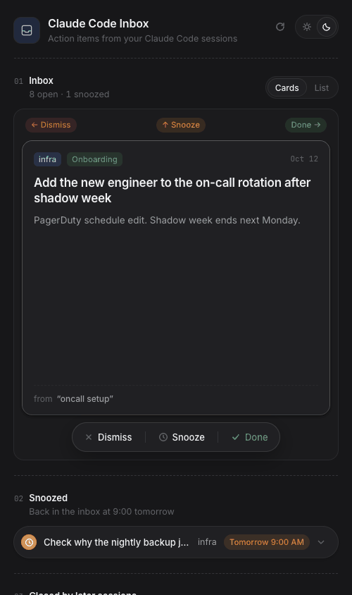
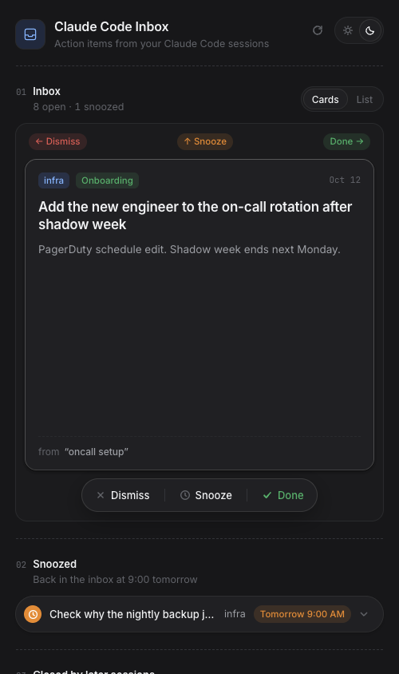
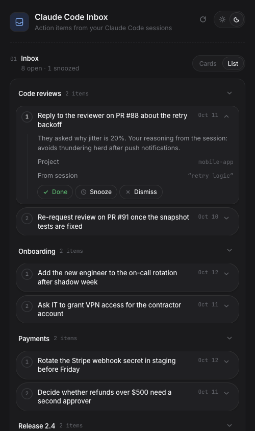
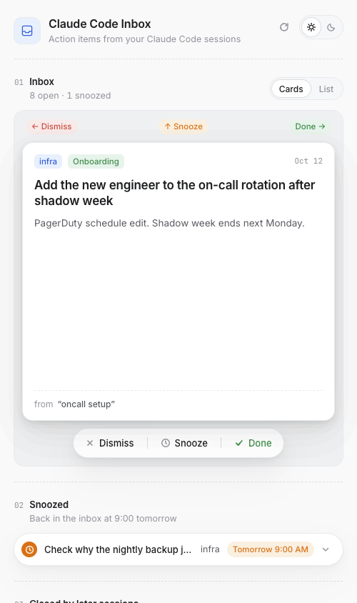
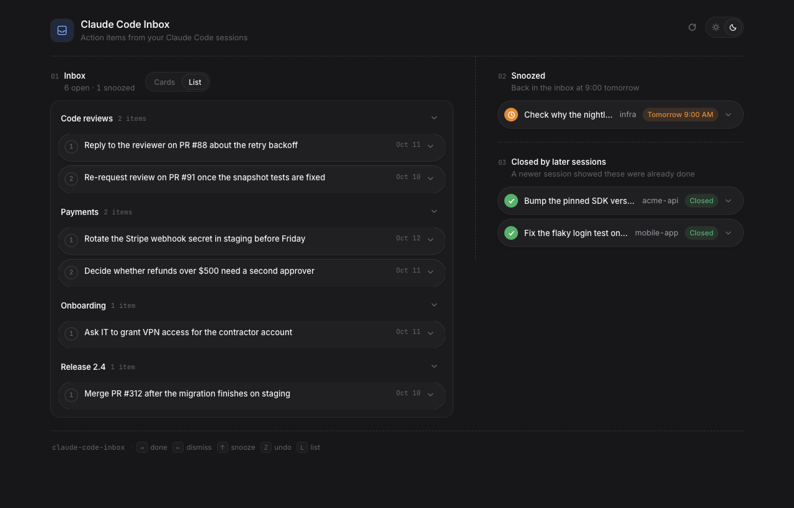

# Claude Code Inbox

Turn your [Claude Code](https://docs.claude.com/en/docs/claude-code) sessions into a swipeable inbox of action items, while they run.

Every session leaves loose ends: "merge this after the migration", "ask the reviewer about the backoff", "rotate that secret on Friday". They live in the transcript and nowhere else. Claude Code Inbox reads the transcript as the session goes, asks Claude to pull out what you still owe, and shows it on your phone as a card stack. Swipe right for done, left to dismiss, up to snooze until tomorrow morning. A later session that completes an item closes it for you.

<p align="center">
  
</p>

<p align="center">
  
  
  
</p>

<p align="center">
  
</p>

On a phone it is a card stack you swipe. On a laptop the inbox sits beside the snoozed and closed lists, and the arrow keys act on the top card (→ done, ← dismiss, ↑ snooze, Z undo, L list, R refresh).

Everything runs on your Mac. It uses your existing Claude Code login, so there is no API key to manage, and nothing leaves the machine except the trimmed transcript sent to Claude for extraction.

## How it works

```
Claude finishes a turn / session ends        refresh button on the phone
        │  Stop / SessionEnd hook (<1 s)              │  POST /api/sweep
        ▼                                             ▼
detached worker ─── trims the transcript ─── claude -p (sonnet) ─── items + topics
        │                                                            resolved_ids
        ▼
SQLite (~/.cc-inbox/ccinbox.db)
        │
        ▼
FastAPI + PWA on your phone        ntfy digest (optional)
```

- **Extraction.** The worker keeps user turns, assistant text, one line per tool call and the first 300 characters of each result, drops subagent chatter and injected context, trims to 80k characters (20% head, 80% tail, since follow-ups cluster at the end), and asks Claude for at most five items, precision over recall. Each item gets a 1–3 word **topic** such as "Payments" or "Code reviews"; the model is shown the project's open items and their topics so it reuses labels instead of inventing near-duplicates.
- **Dedupe and auto-resolve.** The prompt lists open items; the model never re-adds one and may return `resolved_ids` for items the transcript shows were completed. Ids are validated against that project's open items, and a normalised-title fingerprint catches rewordings.
- **Idempotent.** A transcript is processed once per modification time. Failed extractions are retried on the next sweep. One extraction runs at a time.
- **Inbox.** Cards for triage, or a list grouped by topic with collapsible groups and inline actions. Undo on every action. Snoozed items and items closed by later sessions have their own sections.

## Requirements

- macOS (launchd for scheduling; the pipeline itself is plain Python and should run on Linux with cron)
- [Claude Code](https://docs.claude.com/en/docs/claude-code) installed and logged in
- Python 3.11+ and [uv](https://docs.astral.sh/uv/)

## Install

```bash
git clone https://github.com/shrshk/claude-code-inbox.git
cd claude-code-inbox
uv tool install --python 3.12 -e .      # puts `ccinbox` in ~/.local/bin, editable
```

Prefer a plain venv? `uv venv --python 3.12 .venv && uv pip install --python .venv/bin/python -e '.[dev]'` and use `.venv/bin/ccinbox`.

The command is `ccinbox`. State lives in `~/.cc-inbox/`.

## First run

```bash
ccinbox sweep --since-days 1 --dry-run    # which transcripts would be processed
ccinbox render <transcript.jsonl> --limit 3000   # what the model will see
ccinbox sweep --since-days 1 --limit 3    # extract (each session is one model call)
ccinbox list -v                           # the items, with topics
ccinbox serve                             # http://127.0.0.1:8787
```

Already have items from before topics existed? `ccinbox categorize` labels them in one call.

## Hook it into Claude Code

```bash
ccinbox install-hooks           # prints the settings entry
ccinbox install-hooks --write   # merges it into ~/.claude/settings.json (backup written first)
```

Use `--with-stop`; it is the recommended setup and installs three hooks:

| Hook | What it does |
|---|---|
| `Stop` | extracts the session after each reply, debounced |
| `SessionEnd` | extracts the final turns |
| `SessionStart` | `ccinbox ensure-serve`: starts the server detached if nothing listens on its port |

Each hook spawns a detached process and returns at once, well inside Claude Code's hook budget.

`SessionStart` matters more than it looks. A server started this way inherits the terminal's context,
which is what lets the refresh button run the extractor. On some Macs a launchd-started server cannot
(see the known issue under Scheduling). Put your settings in `~/.cc-inbox/env` (copy `env.example`);
`ensure-serve` reads it.

## Phone

Serve on a private network only. The server refuses a non-loopback bind without a token.

```bash
cp env.example ~/.cc-inbox/env   # then set CCINBOX_TOKEN (openssl rand -hex 6) and CCINBOX_HOST=0.0.0.0
ccinbox ensure-serve             # starts the server now; the SessionStart hook keeps it running
```

Then on the phone, on the same Wi-Fi, open `http://<your-mac>.local:8787/?token=<token>`. The Mac's name is under System Settings → General → Sharing → Local hostname. The page stores the token and drops it from the address bar. In Safari, Share → Add to Home Screen gives you a standalone app.

With Tailscale on both devices it works from anywhere: set `CCINBOX_HOST` to the Mac's Tailscale address and use its MagicDNS name. `tailscale serve` can add HTTPS.

Never expose the port to the internet. The token is a single shared secret with no rate limiting.

## When do items show up?

Three ways, all from live sessions:

- **Refresh button.** Tap it on the phone and the server sweeps every session that changed since its
  last extraction, shows a loader with elapsed time, then reloads the inbox and reports what it found.
  Sessions extracted in the last `CCINBOX_REFRESH_DEBOUNCE_SEC` (5 minutes) are skipped, so repeated
  taps are cheap.
- **Stop hook.** Every time Claude finishes a reply, the session is extracted in the background, at most
  once per `CCINBOX_DEBOUNCE_SEC` (15 minutes). Reopening the app refreshes the list.
- **SessionEnd hook.** When you exit, `/clear` or `/resume`, the final turns are picked up.

Both hook workers also sweep any other transcript idle for 10 minutes. No timer is needed.

## Scheduling (launchd)

Optional. `ccinbox install-launchd` renders three agents into `~/Library/LaunchAgents/` with absolute paths and the `CCINBOX_*` variables from your environment. Load the ones you want with `launchctl bootstrap gui/$(id -u) <plist>`.

| Agent | What | When |
|---|---|---|
| `com.ccinbox.serve` | API + PWA (alternative to the SessionStart hook) | always (KeepAlive) |
| `com.ccinbox.sweep` | extraction on a timer, for sessions that never end | every 15 min |
| `com.ccinbox.digest` | ntfy push of open items | weekdays 09:00 |

**Known issue.** On at least one Mac, `claude -p` started from a launchd agent authenticates, opens its API connections, then blocks forever in a file `open()` (0% CPU), while the same command works from any terminal-spawned process. The same applies to a launchd-started `serve` agent: its refresh button would hang in the same place. If `~/.cc-inbox/sweep.log` shows only timeouts, leave the `sweep` and `serve` agents unloaded and rely on the hooks, which run from the terminal's context and work. The author runs it this way. Details and what was ruled out are in [docs/launchd-hang.md](docs/launchd-hang.md). A fix or a confirmed cause would be very welcome.

## Notifications

`ccinbox digest` posts open items grouped by project to `https://ntfy.sh/<CCINBOX_NTFY_TOPIC>`. Pick an unguessable topic name; ntfy topics are public by name. `--dry-run` prints without sending.

## Cost and privacy

- One `claude -p` call per processed session on `CCINBOX_MODEL` (default `sonnet`), run with `--setting-sources ""` (no CLAUDE.md, no skills, no hooks, no plugins), `--tools ""`, `--strict-mcp-config`, `--no-session-persistence` and `--max-budget-usd 0.50`. A trimmed 80k-character transcript is roughly 20k input tokens; in practice about $0.15 per session on Sonnet. `ccinbox stats --sessions 20` shows the log.
- What goes to Claude: the trimmed transcript text and your open item titles. Treat the inbox like the transcripts themselves.
- The extractor cannot trigger itself: it runs with `CCINBOX_EXTRACTING=1` (the hook exits at once), with no hooks loaded, with no session persisted, and from `~/.cc-inbox/work` so any stray transcript is recognised and skipped.

## Commands

| Command | Purpose |
|---|---|
| `ccinbox process <jsonl> [--force] [--then-sweep]` | extract one transcript |
| `ccinbox sweep [--since-days N] [--idle-min N] [--limit N] [--debounce S] [--dry-run] [--json]` | process recent transcripts |
| `ccinbox list [-v] [--all] [--status S] [--json]` | show items |
| `ccinbox act done\|dismiss\|snooze\|undo\|reopen <id>` | act on an item |
| `ccinbox categorize [--all]` | label items with topics |
| `ccinbox render <jsonl>` / `ccinbox prompt <jsonl>` | inspect what the model sees |
| `ccinbox stats [--sessions N]` | counts and cost log |
| `ccinbox serve [--host H] [--port P]` | run the API and PWA |
| `ccinbox digest [--dry-run]` | ntfy push |
| `ccinbox config` | effective settings |
| `ccinbox install-hooks [--write] [--with-stop] [--no-serve]` | Claude Code hooks |
| `ccinbox ensure-serve` | start the server if it is not running (SessionStart hook) |
| `ccinbox install-launchd [--load]` | launchd agents |

## Configuration

Every setting is an environment variable `CCINBOX_<NAME>`; `ccinbox config` prints the effective values.

| Name | Default | Meaning |
|---|---|---|
| `HOME` | `~/.cc-inbox` | DB, logs, lock, work dir |
| `CLAUDE_BIN` | `claude` | absolute path recommended under launchd |
| `MODEL` | `sonnet` | extractor model |
| `MAX_BUDGET_USD` | `0.50` | per-call cap |
| `MAX_CHARS` / `HEAD_RATIO` | `80000` / `0.2` | trimming |
| `TOOL_RESULT_CHARS` / `TOOL_USE_CHARS` | `300` / `200` | per-tool abbreviation |
| `MIN_USER_TURNS` | `2` | shorter sessions are skipped without a model call |
| `MAX_ITEMS` | `5` | per session |
| `SWEEP_DAYS` / `SWEEP_IDLE_MIN` | `1` / `20` | sweep window and idle gate |
| `DEBOUNCE_SEC` | `900` | Stop-hook debounce: one extraction per session per interval |
| `REFRESH_DEBOUNCE_SEC` | `300` | refresh button skips sessions extracted this recently |
| `SNOOZE_HOUR` | `9` | local hour snoozed items return |
| `RESOLVED_STRIP_DAYS` | `7` | how long auto-closed items stay listed |
| `HOST` / `PORT` / `TOKEN` | `127.0.0.1` / `8787` / empty | server |
| `NTFY_URL` / `NTFY_TOPIC` | `https://ntfy.sh` / empty | digest |

## Layout

| Path | Responsibility |
|---|---|
| `ccinbox/config.py` | settings |
| `ccinbox/transcript.py` | JSONL parser and trimming |
| `ccinbox/extract.py` | prompt, `claude -p`, parsing, dedupe, auto-resolve, topics; `process_session()` |
| `ccinbox/db.py` | SQLite schema and queries |
| `ccinbox/hook.py` | SessionEnd/Stop entry point |
| `ccinbox/sweep.py` | backstop over `~/.claude/projects` |
| `ccinbox/notify.py` | ntfy digest |
| `ccinbox/server.py` | FastAPI and static PWA |
| `ccinbox/cli.py` | commands |
| `web/` | vanilla JS PWA, no build step; gestures in `attachDrag()` and `intent()` |
| `tests/` | fixture transcript, pipeline and API tests; the extractor is injectable |
| `tests/eval/` | prompt-precision harness over your own sessions |
| `deploy/`, `hooks/` | launchd templates and the hook snippet |

## Development

```bash
uv venv --python 3.12 .venv && uv pip install --python .venv/bin/python -e '.[dev]'
.venv/bin/python -m pytest
```

Transcript parsing was verified against Claude Code 2.1.28x–2.1.29x. Only `user` and `assistant` records carry conversation; `isSidechain` (subagents), `isMeta` (injected skill bodies and reminders), `thinking` blocks and `<system-reminder>` spans are dropped. If a newer version changes the shape, `ccinbox render` on a real transcript is the first thing to check, and `tests/fixtures/session.jsonl` is where a sanitised line belongs.

To tune the prompt: `python tests/eval/run_eval.py --add <transcript>` for 10–15 of your sessions, judge each extracted title as `act` or `noise` in `tests/eval/cases/*.json`, then `run_eval.py` prints precision. An empty inbox beats a noisy one.

## Design

The UI borrows its visual language from [Beautiful UI](https://www.beautifului.dev/) by Turbo (MIT): the oklch light/dark tokens, Inter and JetBrains Mono, hairline cards on a canvas surface, numbered sections with dashed dividers, the pill action bar, capsule task rows, and the pixel-grid loader.

## License

MIT. See [LICENSE](LICENSE).
